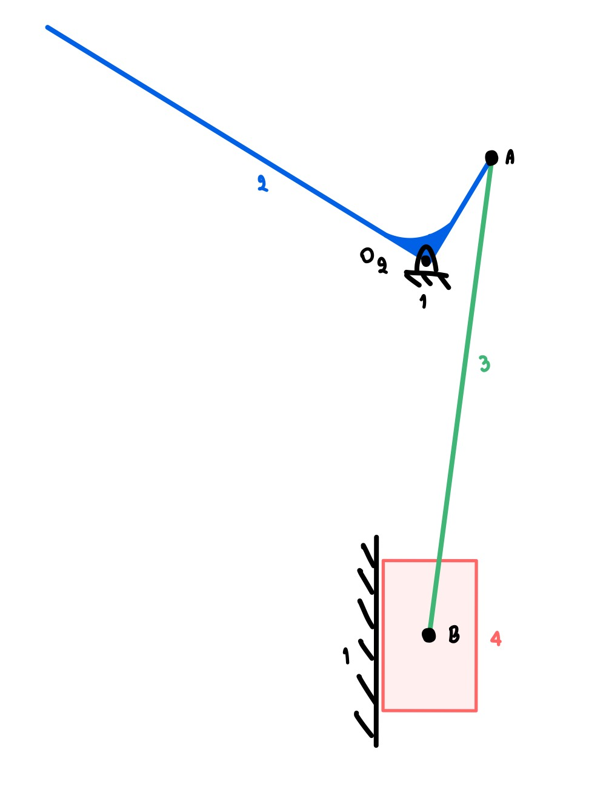

# Toggle-Press

[ชลาธิป นิ่มน้อย] · [Chalathip Nimnoi]  
2103322 MECHANICS OF MACHINERY · Symbolic Mathematics

วิเคราะห์เครื่องกดแบบ toggle ที่เป็นสไลเดอร์–แคร้งก์ในแนวเส้นศูนย์กลาง พร้อมก้านโยกรูปตัว L 

## ไฟล์ส่งงาน

| ไฟล์ | เนื้อหา |
|---|---|
| [Report.docx](Report.docx) | รายงาน 2 หน้า |
| [Report.pdf](Report.pdf) | รายงาน 2 หน้า สำหรับพิมพ์ |
| [Mechanism.mlx](Mechanism.mlx) | Symbolic analysis และคำสั่งรัน |
| [Mechanism.avi](Mechanism.mp4) | ภาพเคลื่อนไหวพร้อมกราฟ s/v/a |
| [Render.jpg](Render.jpg) | ภาพกลไกและกราฟ |
| [simulation/](simulation/) | โค้ด MATLAB ประกอบ |
| [bonus/](bonus/) | วิดีโอและภาพ Synthesis |

## แบบจำลองกลไก



เครื่องตั้งตรง ram กดลงในแนวดิ่ง crank O₂A ยาว 40 mm ติดแข็งกับก้านโยกยาว 150 mm ที่ตั้งฉากกันเป็นรูปตัว L coupler AB ยาว 160 mm ram เลื่อนอยู่บนเส้นผ่าน O₂ (e = 0) ก้านโยกหมุนตามเข็มนาฬิกา มุม θ₂ จาก 150° ถึง 3° ที่ 30 rpm แรงกดงาน 1000 N ทำงานในช่วง 2 mm สุดท้ายของระยะเคลื่อนที่

ลิงก์ 1 ฐาน, 2 crank พร้อมก้านโยก, 3 coupler และ 4 ram ข้อต่อ J1 (O₂), J2 (A), J3 (B) เป็น Revolute และ J4 ระหว่าง ram กับฐานเป็น Prismatic

มี $n=4$, $j_1=4$, $j_2=0$ จึงได้ $M=3(n-1)-2j_1-j_2=1$ ใช้แรงบิดที่ก้านโยกตัวเดียวควบคุมทั้งกลไก

## Symbolic analysis

เขียนสมการปิดวงจรของ crank และ coupler ด้วย Symbolic Math Toolbox แล้วหาอนุพันธ์ตามเวลาด้วยกฎลูกโซ่ได้ตำแหน่ง ความเร็ว และความเร่ง

```math
\theta_3=\arcsin\frac{e-r_2\sin\theta_2}{r_3},\qquad
x_B=r_2\cos\theta_2+r_3\cos\theta_3,
```

```math
v_B=-\frac{r_2\,\omega_2\sin(\theta_2-\theta_3)}{\cos\theta_3},\qquad
\sin\theta_2^{*}=\frac{e}{r_2+r_3}.
```

จุด toggle คือ $\theta_2=\theta_3$ ที่ $v_B=0$ ส่วนแรงใช้สมการ Newton–Euler 8 สมการ 8 ตัวแปร ได้แรงที่ข้อต่อ แรงตั้งฉากของ ram และแรงบิด $T_2$ ตรวจซ้ำด้วยหลักงานเสมือน

```math
T_2=\frac{F_p\,v_B}{\omega_2},\qquad
MA=\frac{r_2|\omega_2|}{|v_B|},\qquad
F_{hand}=\frac{|T_2|}{L_h}.
```


## ผลที่ได้

ram เคลื่อนที่ลง 75.83 mm ใน 0.817 s ยิ่งใกล้จุด toggle ram ยิ่งช้าลงและกลไกขยายแรงมากขึ้น ที่ θ₂ = 3° ได้ MA ประมาณ 15 เท่า

แรงบิดสูงสุดเกิดที่จุดที่ ram เริ่มสัมผัสงาน เพราะตรงนั้น MA ยังต่ำ ต้องใช้แรงที่ปลายก้านโยกสูงสุดประมาณ 89 N หลังจากนั้นแรงมือลดลงเรื่อยๆ จนเหลือประมาณ 17 N ที่ปลาย stroke

สมการถูกต้อง โดยความยาว coupler คงที่ (ผิดพลาด $5.6\times10^{-17}$ m) และแรงบิดจาก Newton–Euler ตรงกับหลักงานเสมือน (ต่างกัน $1.8\times10^{-15}$ N·m)

## Synthesis

กำหนดระยะ stroke แรงกด และแรงมือสูงสุดที่ยอมรับได้ แล้วหา $r_2$, $r_3$ และ $L_h$ ที่ทำให้มุม $\gamma=\theta_2-\theta_3$ ที่ปลาย stroke ไม่ต่ำกว่าค่าที่กำหนด

[ผลสังเคราะห์: ค่าที่เลือก, MA ที่ปลาย stroke, แรงมือสูงสุด]


## การรัน

ดาวน์โหลดและแตก ZIP ทั้งโครงการ ใช้ MATLAB พร้อม Symbolic Math Toolbox เปิด `Mechanism.mlx` แล้วกด Run All หรือรัน [RUN_ALL.m](RUN_ALL.m) ผลใหม่บันทึกใน `results/main/` และ `results/bonus/`

โค้ดหลักอยู่ใน [toggle_model.m](simulation/toggle_model.m), [run_main.m](simulation/run_main.m) และ [run_bonus.m](simulation/run_bonus.m) แก้ค่าพารามิเตอร์ได้ที่บล็อก `PARAMETERS` ต้นไฟล์

แบบจำลองใช้ชิ้นส่วนแข็งเกร็ง ความเร็ว crank คงที่ และไม่มีแรงเสียดทาน แรงกดงานเข้าเป็นขั้นเมื่อ ram สัมผัสงาน มวลของก้านโยกไม่รวมในการคำนวณ หน่วย mm, s, rad, N
