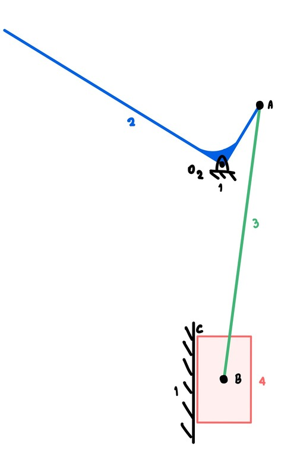
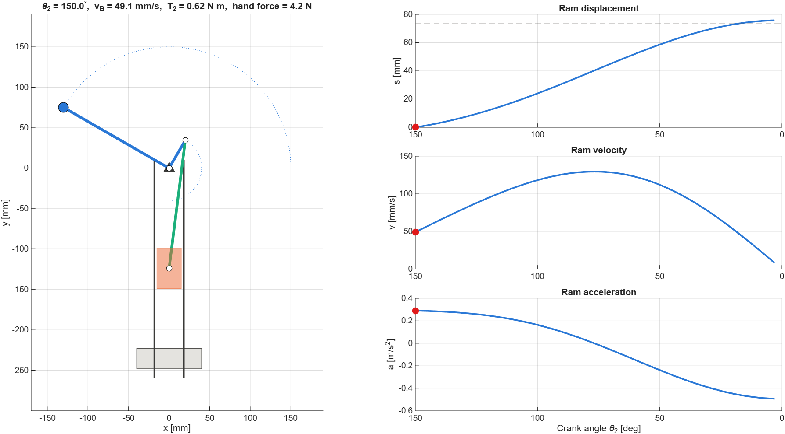
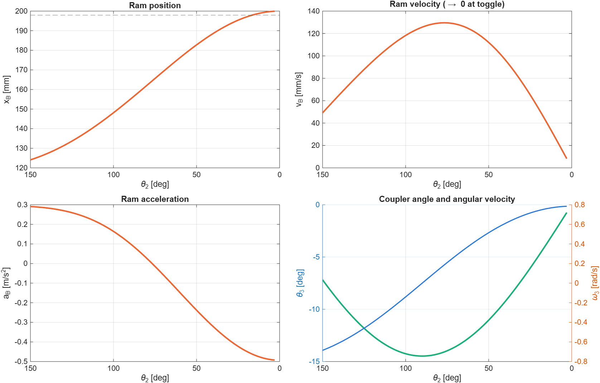
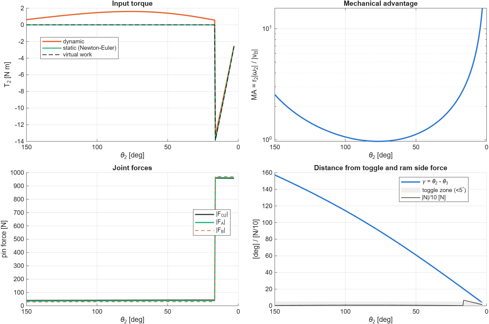
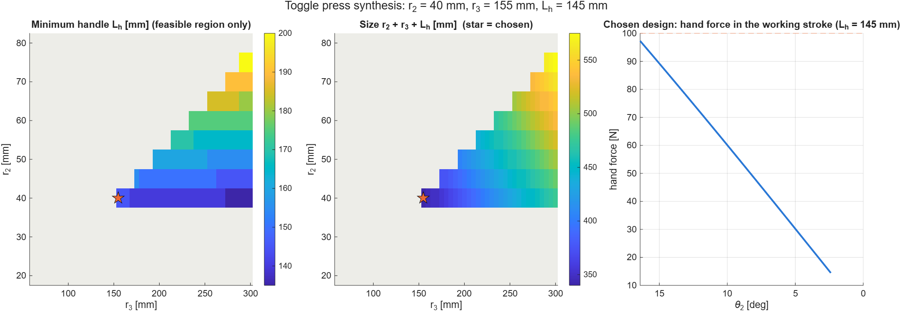

# Toggle-Press

[ชลาธิป นิ่มน้อย] · [Chalathip Nimnoi]  
2103322 MECHANICS OF MACHINERY · Symbolic Mathematics

วิเคราะห์เครื่องกดแบบ toggle ที่เป็นสไลเดอร์–แคร้งก์ในแนวเส้นศูนย์กลาง พร้อมก้านโยกรูปตัว L 

## ไฟล์ส่งงาน

| ไฟล์ | เนื้อหา |
|---|---|
| [Report.pdf](Report.pdf) | รายงาน |
| [toggle_press.m](toggle_press.m) | Script Symbolic analysis |
| [Mechanism.mp4](Mechanism.mp4) | ภาพเคลื่อนไหวพร้อมกราฟ s/v/a |
| [Animation.png](Animation.png) | ภาพกลไกและกราฟ |
| [Synthesis/](Synthesis/) | วิดีโอและภาพ Synthesis |

## แบบจำลองกลไก



เครื่องกดแบบ toggle ตั้งตรง ก้านโยกหมุนตามเข็มนาฬิกาที่ 30 rpm ขับ ram ให้กดลงในแนวดิ่ง crank O₂A ยาว 40 mm ติดแข็งกับก้านโยกยาว 150 mm ที่ตั้งฉากกัน coupler AB ยาว 160 mm และ ram เลื่อนอยู่บนเส้นผ่าน O₂ ($e=0$) แรงกดงาน 1000 N ทำงานในช่วง 2 mm สุดท้ายของระยะเคลื่อนที่

ลิงก์ 1 คือฐานและรางที่ยึดอยู่กับที่ ลิงก์ 2 คือ crank พร้อมก้านโยก ลิงก์ 3 คือ coupler และลิงก์ 4 คือ ram

| จุดต่อ | ลิงก์ | ชนิด |
| ------ | ----- | ---- |
| $O_2$ | 1–2 | (Revolute) |
| $A$ | 2–3 | (Revolute) |
| $B$ | 3–4 | (Revolute) |
| $C$ | 1–4 | (Prismatic) |

มุม $\theta_2$ วัดจากแนวเส้นกลางของ ram (ทิศลง) เป็นบวกทวนเข็มนาฬิกา ก้านโยกหมุนตามเข็มนาฬิกา $\theta_2$ จึงลดจาก 150° เหลือ 3° ส่วน $\theta_3$ คือมุมของ coupler จากแนวเดียวกัน ตำแหน่ง $x_B$ วัดจาก $O_2$ ลงตามแนว ram

มี $n=4$, $j_1=4$, $j_2=0$ จึงได้ $M=3(n-1)-2j_1-j_2=1$ ใช้แรงบิดที่ก้านโยกตัวเดียวควบคุมทั้งกลไก ช่วงทำงานของจุด B คือ $e=0$, $124.1\le x_B\le199.9$ mm (ระยะเคลื่อนที่ 75.83 mm)

## Symbolic analysis

เขียนสมการปิดวงจรของ crank และ coupler ด้วย Symbolic Math Toolbox แล้วหาอนุพันธ์ตามเวลาด้วยกฎลูกโซ่ได้ตำแหน่ง ความเร็ว และความเร่ง

```math
\theta_3=\arcsin\frac{e-r_2\sin\theta_2}{r_3},\qquad
x_B=r_2\cos\theta_2+r_3\cos\theta_3,
```

```math
v_B=-\frac{r_2\,\omega_2\sin(\theta_2-\theta_3)}{\cos\theta_3},\qquad
\sin\theta_2^{*}=\frac{e}{r_2+r_3}.
```

จุด toggle คือ $\theta_2=\theta_3$ ที่ $v_B=0$ ส่วนแรงใช้สมการ Newton–Euler 8 สมการ 8 ตัวแปร ได้แรงที่ข้อต่อ แรงตั้งฉากของ ram และแรงบิด $T_2$ ตรวจซ้ำด้วยหลักงานเสมือน

```math
T_2=\frac{F_p\,v_B}{\omega_2},\qquad
MA=\frac{r_2|\omega_2|}{|v_B|},\qquad
F_{hand}=\frac{|T_2|}{L_h}.
```




## ผลที่ได้

ram เคลื่อนที่ลง 75.83 mm ใน 0.817 s ยิ่งใกล้จุด toggle ram ยิ่งช้าลงและกลไกขยายแรงมากขึ้น ที่ θ₂ = 3° ได้ MA ประมาณ 15 เท่า

แรงบิดสูงสุดเกิดที่จุดที่ ram เริ่มสัมผัสงาน เพราะตรงนั้น MA ยังต่ำ ต้องใช้แรงที่ปลายก้านโยกสูงสุดประมาณ 89 N หลังจากนั้นแรงมือลดลงเรื่อยๆ จนเหลือประมาณ 17 N ที่ปลาย stroke

สมการถูกต้อง โดยความยาว coupler คงที่ (ผิดพลาด $5.6\times10^{-17}$ m) และแรงบิดจาก Newton–Euler ตรงกับหลักงานเสมือน (ต่างกัน $1.8\times10^{-15}$ N·m)



## Synthesis

กำหนดระยะ stroke แรงกด และแรงมือสูงสุดที่ยอมรับได้ แล้วหา $r_2$, $r_3$ และ $L_h$ ที่ทำให้มุม $\gamma=\theta_2-\theta_3$ ที่ปลาย stroke ไม่ต่ำกว่าค่าที่กำหนด

[ผลสังเคราะห์: ค่าที่เลือก, MA ที่ปลาย stroke, แรงมือสูงสุด]




